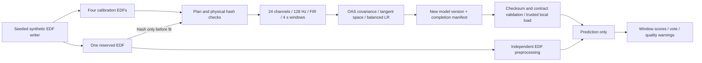

# Architecture and engineering boundaries

The calibration path fixes the 24-channel order, Pz-reference channel labels,
128 Hz target, EDF-relative interval [15,90) seconds, four-second windows and
two-second step. Each input produces 36 windows. The last window is [85,89);
the remaining second is not padded. A tangent-space reference is learned on
calibration windows only. Each EDF contributes classifier sample weights that
sum to one.

`calibrated_highlow/v1.py` validates class balance, declared roles, physical
file identity, date separation, and known stimulus-source separation before
training. It saves a new directory for each model version and writes the
manifest last. The loader checks dependency versions, schema, fixed contract,
model checksum, and fitted pipeline structure before accepting an artifact.
Joblib must only be loaded from a trusted local store: a checksum does not
authenticate a model when an attacker can replace both model and manifest.

Prediction does not call fit, fit_transform, or update the tangent reference.
Integration tests replace those training methods with exceptions during
prediction. The logistic regression class order is High then Low; the exported
High margin negates scikit-learn's Low-positive decision function. Session
votes use the mean High score to resolve ties.

Preprocessing rejects missing channels, inadequate duration or sampling rate,
nonfinite values and flat channels. The reference is verified only by channel
labels. High-amplitude warnings preserve all windows; they do not establish
artifact-free EEG.

The extracted `benchmarking/data_scope.py` contains data structures and generic
grouped split algorithms. It has no manifest loaders and does not establish
dataset eligibility. Callers remain responsible for protected roles, identity,
content independence, and label meaning. Date-held-out folds can include
future training dates; they do not automatically implement prospective testing.
